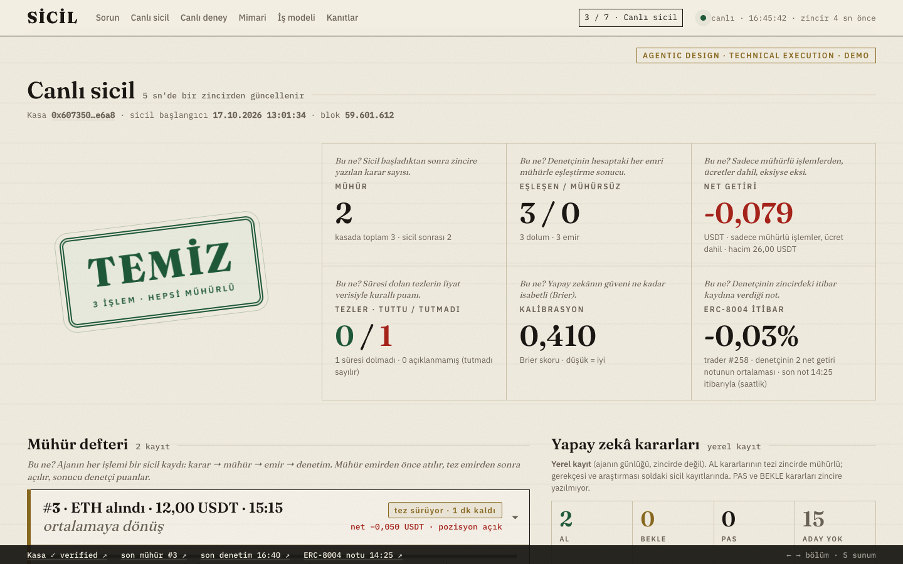
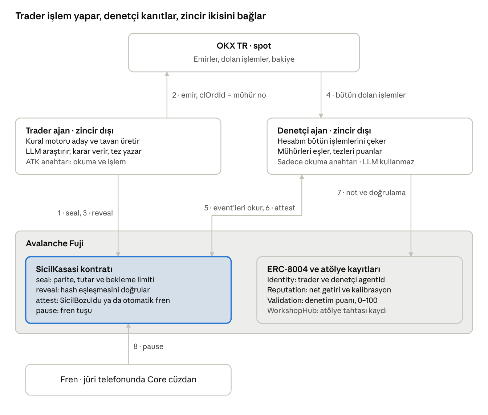

# SİCİL

> **Türkiye'de bir işe girerken sizden istenen ilk belgelerden biri adli sicil kaydıdır. Bugün paramızı yapay zekâ ajanlarına emanet ediyoruz, ama kimse onların sicilini sormuyor. SİCİL'i bunun için yaptık.**
>
> Ajan her işlemden önce kararını Avalanche'a mühürler, bağımsız bir denetçi her işlemi sayar. Kaybettiği günleri bile saklayamaz.

**Kaybettiği günleri bile saklayamayan bir yapay zekâ trader'ı.**

## Jüri kriterleri → kanıt

| Kriter | Puan | Kanıt (tıklanabilir) |
|---|---|---|
| **Agentic Design**: otonomi, muhakeme ve araç kullanımı | 20 | 17 Ekim 13:01'den beri insansız döngü (aday → LLM kararı → mühür → emir → açılış → OCO → denetim). Son mühür [#3 seal](https://testnet.snowtrace.io/tx/0x5bdeecd9fe4d5d73c4289fb85dcdeccc7e652041e4a392a568f08e49b457d20e): yapay zekâ kendi seçtiği 4 OKX ATK aracını sırayla çağırdı (funding, OI, RSI 15m, MACD 1H), AL dedi, tezini yazdı; panelde sicil kartı → "Gerekçeyi ve araştırmayı göster". Kod: [karar.mjs](agents/trader/karar.mjs), [ajan.mjs](agents/trader/ajan.mjs) |
| **Technical Execution**: çalışan ürün, mimari, zorluk | 15 | [Deploy tx](https://testnet.snowtrace.io/tx/0x75eeb4ca34f9e39153e4af4c17222fce75255cad96fe12ac3bb31845a3e75b0c) · [SicilKasasi.sol](contracts/src/SicilKasasi.sol) · [denetci.mjs](agents/denetci/denetci.mjs). Commit-reveal, LLM'siz denetçi (OCO çıkışlarını `algoClOrdId` + `ordIdList` + zamanla mühre bağlar), ERC-8004 "kendi notunu kendi veremez". `forge test` 29 · `node --test` 33 |
| **Avalanche Integration**: C-Chain deploy, güçlü yanlar | 10 | [SicilKasasi (verified, Read Contract)](https://testnet.snowtrace.io/address/0x60735035CC6f4d810f4878f9A4a1993F534fe6a8/contract/43113/readContract) · [son denetim (attest)](https://testnet.snowtrace.io/tx/0xd7f9e65b72e4d36877e9a11043a09916cfb61ccb1e99fdee801e2a8e6efc9547) · [ERC-8004 Reputation notu](https://testnet.snowtrace.io/tx/0xbf051b7214724e149a77684ab7ae4b722d92dcded27bc47880984517b5d59f10). Hızlı kesinleşme: mühür bloğundan OKX emrine 2,5 sn (#3) / 4,6 sn (#2); bir mühür 107.922 gas × 160 wei ≈ 1,7e-11 AVAX (panelde canlı ölçüm). Vizyon: borsalar için özel L1, ICM ile sicilin diğer zincirlerden okunması |
| **OKX Integration**: Agent Trade Kit, OKX.AI servisi | 10 | Üç ayrı `okx-trade-mcp` süreci (yürütücü, `--read-only` anahtarsız LLM, `--read-only` denetçi). [Açılış #3](https://testnet.snowtrace.io/tx/0xd06c0cdba4cb45126ef3429a923c9c6c5f812a323950487be932dae77588ebcb): OKX emir no `4017705195929448449` zincirde · [executor.mjs](agents/trader/executor.mjs) (`post_only`, OCO, `spot_amend_algo_order`). OKX.AI servis örneği: `GET /api/sicil/258` (panel sunucusu, canlı JSON); OKX.AI'da listeleme vizyon |
| **Innovation and Real-World Value** | 25 | Zincire kayıt ≠ sicil: kayıt işlemden **önce**, denetçi **bütün** işlemleri sayar, mühürsüz tek işlem sicili kalıcı bozar. Kullanıcı: OKX TR'de ajan/trader takip etmek isteyen yatırımcı ve başarısını kanıtlamak isteyen geliştirici. SPK uyumlu (spot, kaldıraç yok). İş modeli (vizyon): sicil aboneliği, x402 sorgu ödemesi, OKX TR için sicili doğrulanmış ajan pazarı |
| **Demo and Presentation** | 20 | Panel 7 bölümlük sunum sitesi (→/← ile gezilir, S sunum modu): canlı sicil, **jüri freni** (MetaMask `pause()`; [prova](https://testnet.snowtrace.io/tx/0x4c374def13a602a8e6218bbddd8ac416aaef0eab3d2ac9aaa93fc09488d0a5c7)), mührü kendin doğrula, kontratı kandırmayı dene (4 `eth_call` reddi), Türkçe kuralını yaz |

Görevler: **ana görev** ATK ile otonom ajan ✓ · **Bonus 1** OKX TR spot demo hesabında gerçek emir ve dolumlar (canlı fiyat ve emir defteri, gerçek ücretler) ✓ · **Bonus 2** Avalanche Fuji'de verified kontrat + ERC-8004 ✓

Telegram'daki sinyal gruplarının kâr ekran görüntüleri düzenlenebilir, kaybettiren işlemler gizlenebilir; işlemleri sonradan zincire yazmak da yalnızca seçilenleri kanıtlar. SİCİL'de yapay zekâ ajanı OKX TR spotta her emirden **önce** kararını ve yanlışlanabilir tezini Avalanche'a mühürler. LLM kullanmayan bağımsız bir denetçi ajan hesabın **bütün** dolumlarını mühürlerle eşler, tezleri puanlar ve notu ERC-8004'e yazar. Mühürsüz tek bir işlem sicili zincirde kalıcı olarak "bozuk" yapar.

> Agentic Hackathon · OKX TR × Team1 Türkiye · Avalanche · Ankara, 17 Ekim 2026. Sicil 17 Ekim 13:01:34'te (TR) başladı ve o andan beri insansız çalışıyor.



<!-- Yedek video / GIF: docs/img/demo.gif (sunum öncesi eklenecek) -->

---

## 60 saniyede doğrula

Her bağlantı Snowtrace'te (Avalanche Fuji) açılır; hiçbiri bize güvenmenizi gerektirmez.

| # | Ne görüyorsunuz | Kanıt |
|---|---|---|
| 1 | **Mühür #2**: kararın hash'i, emir OKX'e gitmeden önce zincirde (13:02:31) | [seal tx](https://testnet.snowtrace.io/tx/0x95e4dcf89714bf463ef5e20926530aa2d0807fb566f12f419b1270162b852886) |
| 2 | **Açılış #2**: yön, fiyat, miktar, tez, güven ve salt; hash mühürle eşleşti, tutar mühürü aşmadı. OKX emri `sicil000002` (ordId `4017437100212072450`), mühürden 4,6 sn sonra | [reveal tx](https://testnet.snowtrace.io/tx/0xc2347c8162e9d645a6c14e3c88088a9344cd66bb08e4d0d520c53035d9bd3c4e) |
| 3 | **Denetim**: denetçi bütün dolumları eşledi (mühürsüz 0), rapor hash'ini yazdı | [attest tx](https://testnet.snowtrace.io/tx/0xfe8416b7de54e3837f7fcc2ce32209af024489c953cfb3bbec679f9f7a1418ad) · rapor `reports/1792239356.json` |
| 4 | **Kurallar zincirde, değiştirilemez**: BTC/ETH, işlem başı 20 USDT, günlük 50 USDT zarar, 300 sn, 3 saat | [Read Contract](https://testnet.snowtrace.io/address/0x60735035CC6f4d810f4878f9A4a1993F534fe6a8/contract/43113/readContract) |
| 5 | **Zincir reddetti**: kural motoru 51,02 USDT hesapladı, kontrat 20 USDT limitinde reddetti (`TutarAsildi`) | [reverted tx](https://testnet.snowtrace.io/tx/0xa8a61493bfdee6ca136154073f6c6e62da1db81a33df0e66d1a46d6165b91ed0) |
| 6 | **Jüri freni provası**: fren hesabı `pause()` → ajan sonraki turu atladı → sahip `unpause()` | [pause](https://testnet.snowtrace.io/tx/0x4c374def13a602a8e6218bbddd8ac416aaef0eab3d2ac9aaa93fc09488d0a5c7) · [unpause](https://testnet.snowtrace.io/tx/0x5998f6d243363b730109f6cf2107c2a150e7942cfcce5c1e0ed1d009400e28ef) |
| 7 | **Kendi notunu kendi veremez**: notu ayrı cüzdanlı denetçi verir (ERC-8004 Reputation, trader #258) | [giveFeedback tx](https://testnet.snowtrace.io/tx/0xbdd99ffbbefa9087b9736f6e3ea21d54fff4f01e164814412ff8c7147c66ec49) |

---

## Nasıl çalışır



1. **Karar.** Kural motoru (1H rejim + 15m giriş, ATR'ye göre stop/hedef/tavan) bir **aday** üretir. Yapay zekâ (`gemini-3.8-flash`) en fazla 4 okuma aracıyla araştırır ve **AL / BEKLE / PAS** der; AL derse yanlışlanabilir bir tez yazar (hedef, stop, süre, 0–100 güven). Sayıları kural motoru koyar, yapay zekâ boyutu sadece küçültebilir. Zaman aşımı, bozuk cevap ya da hata → BEKLE.
2. **Mühür.** `keccak256(pair, yön, fiyat, miktar, tez, güven, salt)` → `SicilKasasi.seal()`. Kontrat pariteyi, tutarı, bekleme süresini ve freni kontrol eder; aşan mühür zincirde reddedilir.
3. **Emir.** `Sealed` olayı onaylanmadan emir yok. OKX TR spotta `post_only` alış, `clOrdId = sicil<mühür no>`; dolunca `reveal()` ve OCO çıkışı (`algoClOrdId = sicil<no>x`). Tez süresi dolan OCO, ayrı satış emri olmadan fiyata yakın çekilir.
4. **Denetçi.** LLM yok, sadece-okuma anahtarı. Sicil başladıktan sonraki **bütün** dolumları emir kayıtları üzerinden mühürlerle eşler (etiket + `algoId` + `ordIdList` + zaman + tutar), net getiriyi **sadece mühürlü işlemlerden** hesaplar, tezleri 1 dakikalık mumlarla puanlar (Brier), raporu `reports/` altına yazıp hash'ini `attest()` ile zincire koyar. Mühürsüz tek emir → kalıcı `SicilBozuldu`. Saatte bir ERC-8004 Reputation notu verir.

Panel (`agents/panel`, http://127.0.0.1:8787) jüri kriterlerine göre dizilmiş **7 bölümlük bir sunum sitesi**: giriş, sorun ve kullanıcı, **canlı sicil** (5 sn'de bir güncellenen sicil kartları: karar → mühür → emir → denetim, düz Türkçe tez, fiyat çubuğu, yapay zekânın araç zinciri), **canlı deney** (jüri freni, bir mührü kendin doğrula, kontratı kandırmayı dene, Türkçe kuralını yaz), mimari ve entegrasyonlar (Avalanche'ta canlı ölçümler), iş modeli ve OKX.AI servis örneği (`GET /api/sicil/258`, canlı JSON), kriter → kanıt kapanışı. Klavye: → / ← bölüm, **S** sunum modu; altta canlı kanıt şeridi.

---

## OKX Agent Trade Kit kullanımı

Üç ayrı `okx-trade-mcp` süreci, her biri en az yetkiyle:

| Süreç | Profil | Araçlar |
|---|---|---|
| Yürütücü (kod, LLM değil) | `demo` (okuma + işlem, `site=tr`) | `market_get_candles`, `market_get_ticker`, `market_get_orderbook`, `market_get_instruments`, `spot_place_order`, `spot_cancel_order`, `spot_get_order`, `spot_place_algo_order`, `spot_amend_algo_order`, `spot_get_algo_orders` |
| LLM araştırması | `piyasa` (**anahtar yok**, global), `--read-only` | `market_get_funding_rate`, `market_get_open_interest`, `market_filter_oi_change`, `market_filter`, `market_get_indicator` |
| Denetçi (LLM yok) | `denetci` (sadece okuma), `--read-only` | `spot_get_fills`, `spot_get_order`, `spot_get_algo_orders`, `market_get_ticker`, `market_get_candles` (1m) |

Ayrıca kurulumda `account_get_balance`, `account_get_trade_fee`, `system_get_capabilities` kullanıldı.

**Model:** `gemini-3.8-flash` (`@google/genai`), en fazla 4 araç çağrısı, toplam 45 sn, JSON şemasıyla zorlanmış cevap.

**LLM neden emir veremez?** LLM'in bağlandığı ATK süreci `--read-only` ve anahtarsız çalışıyor: o süreçte yazma aracı hiç yok (doğrulandı: 0 yazma aracı). Emir araçlarını yalnızca yürütücü kodu çağırıyor; LLM'in cevabı bir JSON karar, emir değil.

---

## Zincirdeki adresler (Avalanche Fuji, chainId 43113)

| | Adres |
|---|---|
| SicilKasasi (verified) | [`0x60735035CC6f4d810f4878f9A4a1993F534fe6a8`](https://testnet.snowtrace.io/address/0x60735035CC6f4d810f4878f9A4a1993F534fe6a8) · [kurulum tx](https://testnet.snowtrace.io/tx/0x75eeb4ca34f9e39153e4af4c17222fce75255cad96fe12ac3bb31845a3e75b0c) · [sicilBaslangic tx](https://testnet.snowtrace.io/tx/0x6aa0d08f8d4b615c8abd5b6ea73e04c2d6f3883115ac31f60d95812931bd54c7) |
| ERC-8004 Identity · trader | agentId **258** (sahibi sahip cüzdanı) · [kayıt tx](https://testnet.snowtrace.io/tx/0xdcd083ac031dc89a3176adb6b591b4872d74aa877b1be57913846753fb3448bd) |
| ERC-8004 Identity · denetçi | agentId **259** · [kayıt tx](https://testnet.snowtrace.io/tx/0x2b31497a68af79ba588b92c8208fc6c5ccc0f5da53f1f82d8b0d6d43fa160575) |
| ERC-8004 kayıtları | Identity `0x8004A818BFB912233c491871b3d84c89A494BD9e` · Reputation `0x8004B663056A597Dffe9eCcC1965A193B7388713` · Validation `0x8004Cb1BF31DAf7788923b405b754f57acEB4272` |
| Roller | sahip `0x8394…90A8` · trader `0x7c99…4E07` · denetçi `0x9632…3D02` · fren `0xFD05…c35e` (MetaMask) |
| Team1 WorkshopHub | `0x0a5aa2e3809fa20350182ac481dae69a043bc95d` (kasa `report()` ile kayıt) |

---

## Testler

```bash
cd contracts && forge test          # 29 test: "29 tests passed, 0 failed"
cd agents && npm install && node --test denetci/denetci.test.mjs trader/kurtarma.test.mjs trader/sure-cikis.test.mjs panel/kural-gosterim.test.mjs
                                     # 33 test: "ℹ pass 33 · ℹ fail 0"
```

`forge test`'in viem hash testi `ffi` ile `agents/shared/commit.mjs`'i çalıştırır; bu yüzden önce `agents/` içinde `npm install` gerekir.

## Çalıştırma

Gereksinim: Node 22+, [Foundry](https://book.getfoundry.sh), OKX ATK (`npm i -g @okx_ai/okx-trade-mcp @okx_ai/okx-trade-cli`).

```bash
cd agents && npm install
nohup node panel/sunucu.mjs &          # panel: http://127.0.0.1:8787  (sadece okuma)
nohup trader/calistir.sh &             # trader ajan, 15 dk'da bir tur (caffeinate + otomatik yeniden başlatma)
nohup denetci/calistir.sh &            # denetçi, 60 sn'de bir
```

Gereken anahtarlar (**hiçbiri repoda değil**):

| Ne | Nerede |
|---|---|
| OKX TR demo API anahtarları: `demo` (okuma + işlem), `denetci` (sadece okuma), `piyasa` (anahtarsız, `site = "global"`) | `~/.okx/config.toml` |
| Gemini API anahtarı | repo kökünde `.env` → `GEMINI_API_KEY` (gitignore'da) |
| Fuji cüzdanları `sicil-sahip`, `sicil-trader`, `sicil-denetci` | `~/.foundry/keystores/` (şifreli Foundry keystore) |
| Fren hesabı | Brave + MetaMask (Account 1) |

Ayrıntılı geliştirici notları: [docs/GELISTIRME.md](docs/GELISTIRME.md) · kararlar ve gerekçeleri: [memory-bank/decisionLog.md](memory-bank/decisionLog.md) · mimari: [memory-bank/systemPatterns.md](memory-bank/systemPatterns.md) · kontrat: [contracts/README.md](contracts/README.md).

---

## Dürüst sınırlar

- **Demo hesap ve test ağı.** İşlemler OKX TR **demo** hesabında (gerçek emir motoru, sanal para); zincir Avalanche **Fuji** test ağı.
- **"Kâr eder" demiyoruz.** İddiamız dürüst sicil. Net getiri ücretler dahil şu an eksi; olduğu gibi gösteriliyor. Sakin piyasada az sayıda tez sonuçlandı, kalibrasyon için örnek az.
- **Türkçe kural.** Kullanıcının kuralını bugün ekip sayılara çevirip kasa kurulumunda kontrata yazdı. Panelde "Kuralını yaz" ekranı bunun yapay zekâ ile nasıl yapılacağını **gösterir**, ama gerçek kontrat kurmaz. Hedef: her kullanıcıya kendi kurallarıyla kendi kasası.
- **Kontrat emri fiziksel olarak engellemez.** Para OKX'te, emri yürütücü gönderir. Kontrat "yapamazsın" değil "yaparsan herkes görür" der: limit aşan mühürleri reddeder, mühürsüz tek bir dolum ise denetçi tarafından yakalanıp sicili **kalıcı** olarak bozar.
- **Denetçi de bizim kodumuz.** Ama LLM kullanmıyor, sadece okuma anahtarıyla çalışıyor ve açık kaynak: aynı anahtar ve zincirle herkes aynı sonuca ulaşır.
- **"10 hesap açıp en iyisini gösterme"** sorununa cevabımız kısmi: Identity kaydında sahibin bütün ajanları görünür; tam çözüm borsanın doğrulanmış hesabı agentId'ye bağlaması.
