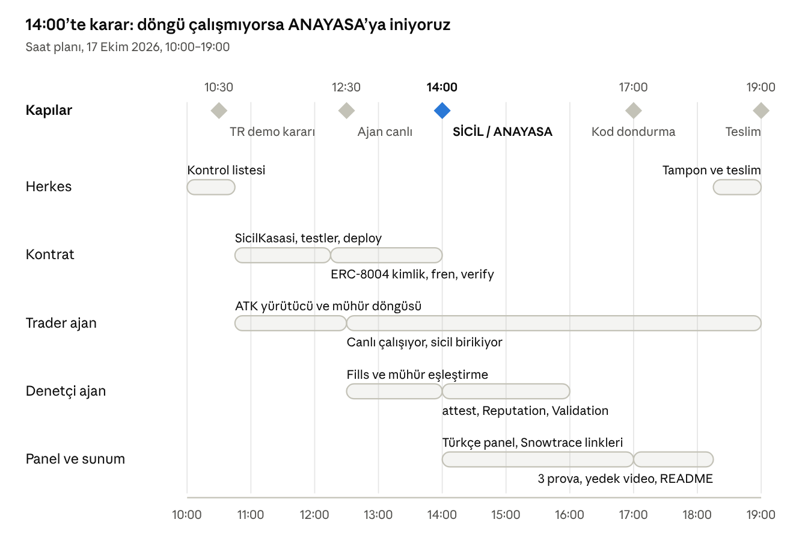

# Progress

> Kutucukları işaretle, saat yaz. Doğrulama kaydına her testin sonucunu ekle.

## Yol haritası

| Aşama | Durum |
|---|---|
| 0. Araştırma: geçmiş OKX / Avalanche / İstanbul kazananları | ✅ 16 Ekim |
| 1. Fikir seçimi: KUYRUK → SİCİL | ✅ 16 Ekim |
| 2. Gece kurulumu | 🟡 Devam ediyor |
| 3. Hackathon günü: 10:00–19:00 | ⬜ 17 Ekim |
| 4. Sunum: 20:00 | ⬜ 17 Ekim |

## Aşama 2: Gece kurulumu (16 Ekim)

- [x] Node.js (v22.22.0)
- [x] ATK MCP + CLI 1.4.8 kur; TR piyasa verisini test et
- [x] Foundry 1.8.5 kur; Fuji RPC ve cancun derlemesini test et
- [x] 4 Fuji cüzdanı (şifreli keystore) oluştur
- [x] Test AVAX al ve dağıt (sahip 0,19 · trader 0,15 · denetçi 0,10 · fren 0,05)
- [x] Memory bank ve proje notları
- [x] Ekip incelemesi: 4 eksik plana eklendi
- [ ] **Bu gece commit atma** (ilk commit yarın 10:00)
- [ ] OKX TR demo erişimi + 2 API anahtarı (trader: okuma+işlem, denetçi: sadece okuma)
- [ ] `okx config init` → `demo` ve `denetci` profilleri; bakiye testi
- [x] Fren adresi kararı: K-14, Brave'deki MetaMask (Account 1) `0xFD05…c35e`
- [ ] "Örnek" etiketli sahte sinyal ekran görüntüsü (slayt 1)
- [ ] Slayt iskeleti, sunum metni, soru-cevap tablosu ekipte paylaşıldı
- [ ] İş bölümü kesinleşti (aşağıdaki tabloya isim yaz)
- [ ] Organizatöre "önceden kod serbest mi" soruldu
- [ ] Diğer ekip üyelerinin makinelerinde ATK + Foundry kurulu

## Aşama 3: Hackathon günü

### Karar kapıları

| Saat | Kapı | Şart | Durum |
|---|---|---|---|
| 10:30 | TR demo kararı | TR demo profili ile bakiye + bir `post_only` emir çalışıyor mu? Hayırsa canlı küçük spot hesap veya global demo | ✅ 11:45 TR demo çalışıyor |
| 12:30 | Ajan canlı | Trader ajan insansız çalışmaya başladı; sicil birikiyor | ✅ 13:02 (`sicilBaslangic` 13:01:34 TR) |
| **14:00** | **SİCİL / ANAYASA** | En az bir işlem mühür → emir → açıklama döngüsünü uçtan uca tamamladı mı? Hayırsa ANAYASA | ✅ **SİCİL** (12:31 elle, 13:03 otonom) |
| 17:00 | Kod dondurma | Yeni özellik yok; sadece hata düzeltme, prova, video | ⬜ |
| 19:00 | Teslim | Repo, README, video | ⬜ |

### İş kolları

| Kol | Sorumlu | Saat | İş |
|---|---|---|---|
| Herkes | — | 10:00–10:45 | Sabah kontrol listesi |
| Kontrat | _isim_ | 10:45–12:15 | SicilKasasi, Foundry testleri, deploy |
| Kontrat | _isim_ | 12:15–14:00 | ERC-8004 kimlikleri, fren, verify |
| Trader ajan | _isim_ | 10:45–12:30 | ATK yürütücü ve mühür döngüsü |
| Trader ajan | _isim_ | 12:30–19:00 | Canlı çalışıyor, sicil birikiyor (LLM karar katmanı burada olgunlaşır) |
| Denetçi ajan | _isim_ | 12:30–14:00 | Dolumlar ve mühür eşleştirme |
| Denetçi ajan | _isim_ | 14:00–16:00 | `attest`, Reputation, Validation |
| Panel ve sunum | _isim_ | 14:00–17:00 | Türkçe panel, Snowtrace linkleri |
| Panel ve sunum | _isim_ | 17:00–18:15 | 3 prova, yedek video, README |
| Herkes | — | 18:15–19:00 | Tampon ve teslim |

Dört kişiyseniz her kola bir kişi; üç kişiyseniz kontratı bitiren kişi 14:00'te panel ve sunum koluna geçer.

### Sabah kontrol listesi (10:00–10:45)

**Organizatöre:**
- [ ] Önceden kod veya şablon kullanmak serbest mi? (Bu repo sadece doküman ve şablon içeriyor.)
- [ ] Takım büyüklüğü, teslim formatı (repo / video / slayt)?
- [ ] Demo hesapla yapılan işlemler Bonus 1 için sayılıyor mu?
- [ ] TR hesabında (demo dahil) vadeli işlem açık mı? (Sadece bilgi.)

**OKX ve ATK:**
- [ ] `okx --version` = 1.4.8, `okx diagnose` temiz, profilde `site = "tr"`
- [x] TR demo çalışıyor mu? (bakiye, `system_get_capabilities`) ✅ 11:40
- [x] `spot_place_order` ile `post_only` + `clOrdId` (ör. `sicil000001`) emir gidiyor mu? Fiyat demo piyasa verisinden mi alınmalı?
- [ ] `spot_get_order` ve `spot_get_fills` yanıtlarında `clOrdId` geri okunuyor mu? (`spot_get_order` ✅; fills için dolum gerekiyor)
- [x] `spot_place_algo_order` OCO kabul ediliyor mu? ✅ (12:05; ayrıntı doğrulama kaydında) `algoClOrdId` ile işaretlenebiliyor mu? Tetiklenen çıkış emrinde `algoId`/`algoClOrdId` görünüyor mu?
- [x] Denetçi için sadece okuma anahtarı çalışıyor mu? ✅ (smart registration gizlemiyor → `--read-only` zorunlu)
- [x] `news_get_by_coin` TR anahtarıyla çalışıyor mu? ❌ demo modda kapalı; canlı Read anahtarı ya da OAuth gerekir
- [x] BTC-TRY'de 20 USDT'lik emir ne kadar kayıyor? Canlı 5,8 bps; demo defteri bozuk → BTC-TRY eklenmedi

**Avalanche Fuji:**
- [ ] Dört cüzdanda AVAX var mı? (16 Ekim: var)
- [x] Boş bir kontrat deploy + verify (cancun) ✅ 12:00 (`SicilPing`)
- [x] `register` ile iki agentId (trader **258**, denetçi **259**, 12:35); ~~Reputation ve Validation imzaları Snowtrace'te kontrol~~ ✅ imzalar 12:15 doğrulandı
- [x] Denetçi cüzdanından `giveFeedback` ✅ 13:24 (gerçek not, deneme değil)
- [ ] Salon Wi-Fi'sinde olay dinleme gecikmesi; yedek RPC ve telefon hotspot'u
- [x] Fren: Brave + MetaMask Account 1, panelden denendi ✅ 13:49 `pause()` → 14:00 ajan turu atladı → 14:03 sahip `unpause()`
- [ ] **WorkshopHub `checkIn`'i deneme olarak YAPMA** (aynı adresten ikinci kaydı reddediyor)

**Repo ve sicil:**
- [x] Repo açıldı, ilk commit gün içinde atıldı (17 Ekim ~12:25, https://github.com/krsmer/sicil, private)
- [x] Sabah test emirleri `sicilBaslangic`'ten **önce** atıldı (sicile girmeyecekler); `sicilBaslangic` = 1792231294 (13:01:34 TR), tx `0x6aa0d08f…54c7`

### Asla kesilmeyecekler
Mühür → emir → açıklama döngüsü · denetçi ajan ve `SicilBozuldu` · jüri freni · verified kontrat.

### Zaman yetmezse kesilecekler (sırayla)
1. x402 abonelik (zaten plan dışı)
2. İkinci hesapta canlı yakalama
3. Haber ve duygu araçları (LLM daha az veriyle karar verir)
4. BTC-TRY paritesi
5. Validation kaydı (Reputation ve kontrattaki `attest` kalır)

## Teslim ölçütleri (19:00)

- [ ] **Repo public yapılmadan ÖNCE: git geçmişinin TAMAMINDA gizli bilgi taraması** (`git log -p --all` üzerinde anahtar/şifre/özel anahtar/passphrase/e-posta desenleri; ör. `gitleaks detect` veya `git log -p --all | grep -E ...`). Bulunursa geçmiş temizlenir (BFG/`git filter-repo`), sonra public. Commit e-postası ve `ai-docs/sources/` lisansı da kontrol edilir
- [ ] Repo: tek komutla kurulum, gizli anahtar yok, `DRY_RUN` modu
- [ ] README: jüri kriterlerine göre kanıt tablosu (her iddia → Snowtrace / OKX emir numarası), ATK araç çağrı zinciri, kullanılan model ve prompt'lar
- [ ] Foundry test çıktısı
- [ ] SicilKasasi verified, adres README'de
- [ ] Yedek video (17:30 çekimi)

## Doğrulama kaydı

| Tarih | Ne test edildi | Sonuç |
|---|---|---|
| 16 Ekim 20:35 | `okx --site tr market ticker BTC-USDT` | ✅ Çalışıyor |
| 16 Ekim 20:35 | TR'de `USDT-TRY`, `BTC-TRY` pariteleri | ✅ Var |
| 16 Ekim 20:37 | Fuji RPC `cast chain-id` | ✅ 43113 |
| 16 Ekim 20:37 | `AgentDecisionLog.sol` şablonu cancun ile derleme | ✅ `evmVersion: cancun` |
| 16 Ekim 20:40 | 4 keystore: şifreyle açma + imza + doğrulama | ✅ |
| 16 Ekim 20:50 | Sahip → trader/denetçi/fren AVAX transferi | ✅ 3 işlem başarılı |
| 16 Ekim | ERC-8004 üç proxy adresinde kod ve implementasyon | ✅ |
| 16 Ekim | ATK araç adları (SİCİL'in kullandıkları) kaynak kod ve katalogla | ✅ (bkz. `techContext.md`) |
| 16 Ekim 21:30 | WorkshopHub `0x0a5aa2e3…bc95d` adresinde kontrat kodu | ✅ |
| 17 Ekim | Repo taraması: `okx --version` 1.4.8, `forge` 1.8.5, 4 keystore yerinde | ✅ |
| 17 Ekim 11:25 | `~/.okx/config.toml` `demo` profili (TR demo anahtarı: Read+Trade, Spot, USDT/BTC/ETH+1) | ✅ `okx --profile demo account balance` çalışıyor: USDT 5000, BTC 1, ETH 1, TRY 200000, OKB 100 (~$104,8k). `denetci` profili henüz yok |
| 17 Ekim | `node --version` | ⚠️ v25.6.1 (PATH); belgelenen v22 ayrıca kurulu |
| 17 Ekim | TR demo trading var mı | ✅ Var: tr.okx.com → More → Demo trading; demo API: profil → Demo Trading API → "Create V5 API key for demo trading" |
| 17 Ekim | TR demo piyasa (arayüzden, USDT/TRY) | ⚠️ Demo fiyatı 29,00 TRY (canlı ~49), 24s hacim 0; demo ücreti maker %0,10 / taker %0,20 (sıfır değil). BTC-USDT/ETH-USDT demo likiditesi kontrol edilecek |
| 17 Ekim 11:27 | Demo piyasa verisi BTC-USDT | ✅ `--demo` ile: son fiyat canlıyla aynı (~81.717), makas 0,1 $, 24s hacim ~39k BTC → likit. **CLI'da `--demo` verilmezse profil demo olsa da canlı veri döner.** USDT/TRY demo fiyatındaki sapma TRY'ye özgü |
| 17 Ekim 11:40 | `denetci` profili (TR demo, sadece Read) | ✅ `account balance` çalışıyor (aynı demo hesap) |
| 17 Ekim 11:40 | ATK "smart registration" (Trade izni yoksa emir araçlarını gizler) | ❌ **TR demo'da çalışmıyor**: Read-only anahtarla da 12 yazma aracı listeleniyor. `--read-only` bayrağıyla 0 yazma aracı ✅. Sonuç: denetçi ve LLM süreçlerinde `--read-only` **zorunlu**; borsa tarafında da anahtar zaten Read-only |
| 17 Ekim 11:45 | İlk TR demo emri: BTC-USDT buy `post_only` 0,00012 @ 80880,9 (bid −%1), `clOrdId=sicil000001` → ordId 4017254314926780417 | ✅ `sCode 0`, gönderim ~1 sn. `spot get --clOrdId` ile geri okundu (trader ve denetçi anahtarıyla). İptal edildi, `state=canceled`, dolum yok. Emir nesnesinde `algoId`/`algoClOrdId`/`attachAlgoClOrdId` alanları **var** (boş) → OCO eşleştirmesi için umut verici. ATK emre `tag: "CLI"` ekliyor. BTC-USDT: minSz 0,00002, tickSz 0,1 |
| 17 Ekim 11:50 | OCO (4a, tetiklenmeyen): sell 0,00012 BTC, TP +%5 / SL −%5 (piyasa), `algoClOrdId=sicil000001x` → algoId 4017257012736667649 | ✅ Kabul edildi; denetçi anahtarıyla `spot algo orders` içinde `algoClOrdId` geri okundu; iptal edildi (pending boş). CLI'da algoClOrdId bayrağı `--clOrdId`; `--tpOrdPx=-1` `=` ile yazılmalı. `--history` varsayılan olarak sadece `effective` (tetiklenmiş) olanları gösteriyor |
| 17 Ekim 12:05 | OCO (4b): `algoClOrdId=sicil000002x`, SL −%0,02 → doğal tetiklendi (SL tarafı), market satış dolumu | ✅ **Bağlantı kurulabiliyor, ama sadece emir üzerinden.** Tetiklenen emir: ordId 4017280697166049281, `clOrdId="O4017280697042617344"` (**borsa üretiyor, bizim değil**), `algoId` + `algoClOrdId=sicil000002x` **emirde dolu**, `source="7"`. **Dolum kaydında `algoClOrdId` yok** (sadece ordId, clOrdId=O…). Tek emir **2 dolum** olarak geldi. Taker ücreti %0,10 (`feeRate -0.001`). Algo geçmişinde `ordIdList` + `actualSide: "sl"` var |
| 17 Ekim 12:05 | `news` modülü TR demo anahtarıyla | ❌ "News features are not available in demo/simulated trading mode." Demo anahtar + `--live` → 50101 (ortam uyuşmazlığı). Anahtarsız çalışmıyor (`okx-auth` istiyor). Açmanın yolu: **canlı** TR anahtarı (sadece Read) ya da `okx-auth login --site tr` (OAuth) |

| 17 Ekim 12:30 | 20 USDT (988 TRY) emrin kayması, emir defterinden (emir yok) | BTC-USDT canlı ve demo: makas ~0, kayma 0 bps (1 kademe) ✅. BTC-TRY **canlı**: makas 11,5 bps, piyasa emri kayması 5,8 bps (1 kademe), ilk 5 kademe ~0,9–1,2 M TRY. BTC-TRY **demo: kullanılamaz** (orta fiyat 130 TRY, satış tarafında 6 TRY derinlik) ❌ |

| 17 Ekim 12:00 | Foundry projesi `contracts/` (forge-std v1.17.0 submodule, şablon `foundry.toml`: solc 0.8.24, cancun) + `SicilPing` test kontratı | ✅ `forge build`/`forge test` geçti, metadata `evmVersion: cancun` |
| 17 Ekim 12:00 | Fuji deploy (`sicil-sahip`): `SicilPing` → `0xDf769dE9Fc427863C8CC4cf7231226a93c2435f6`, tx `0x4ad1bd17…6a09` | ✅ ~4 sn (gönderim + onay) |
| 17 Ekim 12:00 | Verify: Builder Hub Sourcify | ✅ iş `exact_match` (Builder Hub explorer). Not: `/v2/contract/...` sorgusu hemen `match: null` döndü |
| 17 Ekim 12:01 | Verify: Snowtrace (Routescan Etherscan API) | ✅ forge: `Pass - Verified`. Routescan `getsourcecode` API'si birkaç dk sonra hâlâ boş → Snowtrace sayfasından gözle doğrula |
| 17 Ekim 12:15 | ERC-8004 imzaları (Routescan verified kaynak, v2.0.0) | ✅ Planla uyumlu. Self-feedback engeli kontratta; `validationRequest` sadece sahip/operatör; `validationResponse` sadece validator, ≤100 |
| 17 Ekim 12:35 | ERC-8004 `register`: sahip → trader (258), denetçi → kendisi (259) | ✅ ownerOf doğru; `isAuthorizedOrOwner(denetçi,258)=false`; tokenURI zincirden çözüldü |
| 17 Ekim 13:25 | `SicilKasasi` Fuji deploy `0x60735035CC6f4d810f4878f9A4a1993F534fe6a8` | ✅ Zincirden okunan ayarlar doğru; Builder Hub `exact_match`, Snowtrace verified (SicilKasasi, v0.8.24) |
| 17 Ekim 12:30 | Uçtan uca döngü (mühür #1 → post_only `sicil000001` → reveal → OCO `sicil000001x`) | ✅ Mühür ~5 sn, dolum ~29 sn, reveal ~5 sn; demo maker ücreti %0,08 (BTC olarak kesildi) |
| 17 Ekim 12:45 | `sealRetGoster` (simülasyonsuz, gas 200k): 34 USDT mühür | ✅ Zincirde `reverted`, `TutarAsildi(3400, 2000)`: tx `0xe2206eb4…48bd1` (sicilBaslangic öncesi test) |
| 17 Ekim 12:45 | Kural motoru (1H demo mumları, EMA20/50, ATR14) | ✅ Çalışıyor; o an BTC ve ETH yatay → aday yok. BTC ATR ~%0,41 → ham tutar ~49 USDT > 20 (ret anı doğal olarak oluşur) |
| 17 Ekim 12:42 | OCO tetiklenmesi (yürütücü döngüsü, mühür #1) | ✅ SL tetiklendi, çıkış @ 81.650,4. Çıkış **emrinde** `algoId` + `algoClOrdId=sicil000001x` var, **dolumda** yok → denetçi dolum→ordId→emir zinciriyle eşler. İşlem sonucu ≈ −0,005 USDT fiyat + ≈ −0,027 USDT ücret |
| 17 Ekim 13:01 | `setSicilBaslangic()` (ön kontrol: açık emir 0, bekleyen algo 0) | ✅ `sicilBaslangic = 1792231294`, tx `0x6aa0d08f8d4b615c8abd5b6ea73e04c2d6f3883115ac31f60d95812931bd54c7` |
| 17 Ekim 13:03 | **İlk otonom döngü** (ajan.mjs, nohup): BTC-USDT ortalamaya dönüş adayı → Gemini AL (çarpan 0,7, güven 64, 90 dk) → ret anı (51,02 > 20 USDT, zincirde reverted `0xa8a61493…1ed0`) → mühür #2 → `sicil000002` doldu (~40 sn) → reveal → OCO `sicil000002x` (çıkış miktarı ücret düşülmüş: 0,00017148) | ✅ İnsan müdahalesi yok |
| 17 Ekim 13:13 | Denetçi kuru tur | ✅ 1 mühür (#2), 1 emir eşleşti, 0 eşleşmeyen, net −0,008 USDT, tez bekliyor |
| 17 Ekim 13:14 | **İlk attest** (denetçi cüzdanı) | ✅ `reports/1792232075.json`, tx `0x44a02282ac5ebaee6f81fc4f530ebdffbdd0098b409d8c2f0b9a4643838c1767`; SicilBozuldu yok |
| 17 Ekim 13:15 | Denetçi birim testleri (`node --test denetci/denetci.test.mjs`) | ✅ 10/10: sabahki `sicil000002x` (algo sicil öncesi) reddedilir, sahte algoId, ordIdList, mühürsüz, mühür emirden sonra, tutar aşımı, fazla satış, net getiri |
| 17 Ekim 13:24 | **İlk ERC-8004 Reputation notu** (denetçi → trader agentId 258) | ✅ net-getiri −5 (valueDecimals 2 = −%0,05), feedbackURI `raw.githubusercontent.com/krsmer/sicil/main/reports/1792232666.json`, feedbackHash = attest'teki rapor hash'i; tx `0xbdd99ffbbefa9087b9736f6e3ea21d54fff4f01e164814412ff8c7147c66ec49`. Zincirden `getSummary(258,[denetçi],"net-getiri","sicil") = (1, −5, 2)`. Kalibrasyon notu: henüz puanlanmış tez yok (Brier null) → ilk tez sonuçlanınca |
| 17 Ekim 13:24 | Denetçinin rapor commit+push'u | ✅ `fb1f44a denetçi: 1 rapor` (sadece `reports/`) |
| 17 Ekim 13:33 | Türkçe panel (`agents/panel/`, http://127.0.0.1:8787) | ✅ API + sayfa; agent-browser ekran görüntüsüyle kontrol edildi. Fren butonu MetaMask ile provada denenecek |
| 17 Ekim 13:40 | 15m ATR seviyeleri, rapor tabanlı tez geçmişi, güvenli rapor push'u | ✅ 16/16 test (denetçi 10 + kurtarma 6); trader ve denetçi yeni koda geçti |
| 17 Ekim 13:49 | **Fren provası** (panel → MetaMask Account 1 → `pause()`) | ✅ pause tx `0x4c374def13…` (fren adresinden), 14:00 trader turu "kasa durdurulmuş (fren)" ile atlandı, 14:03 sahip `unpause()` tx `0x5998f6d243…`. Arif: "sorunsuz çalışıyor" |
| 17 Ekim 14:30 | Panel kurallar kartı + Snowtrace Read Contract linki | ✅ Değerler kontrattan; link gerçek tarayıcıda açıldı ve kasanın 19 okuma fonksiyonunu listeliyor (Snowtrace verified gözle doğrulandı) |
| 17 Ekim 14:45 | "Kuralını yaz" gösterimi (`POST /api/kural`) | ✅ 8/8 aralık testi; canlı: Arif'in kuralı ve "sadece ETH, 10/30" kabul; "SOL+BTC, 100 USDT, 10x kaldıraç" ve "40/20" ret (nedenleriyle); yanıtlarda Gemini anahtarı yok |
